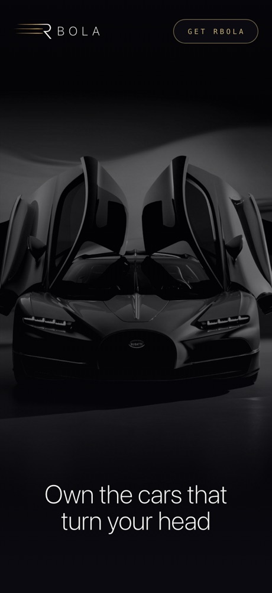
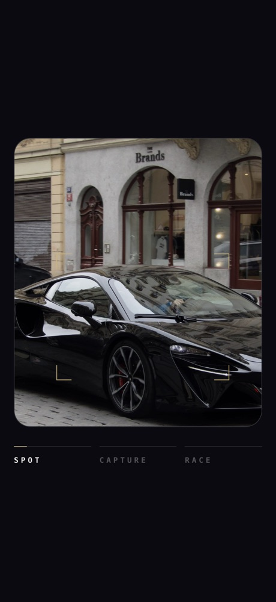
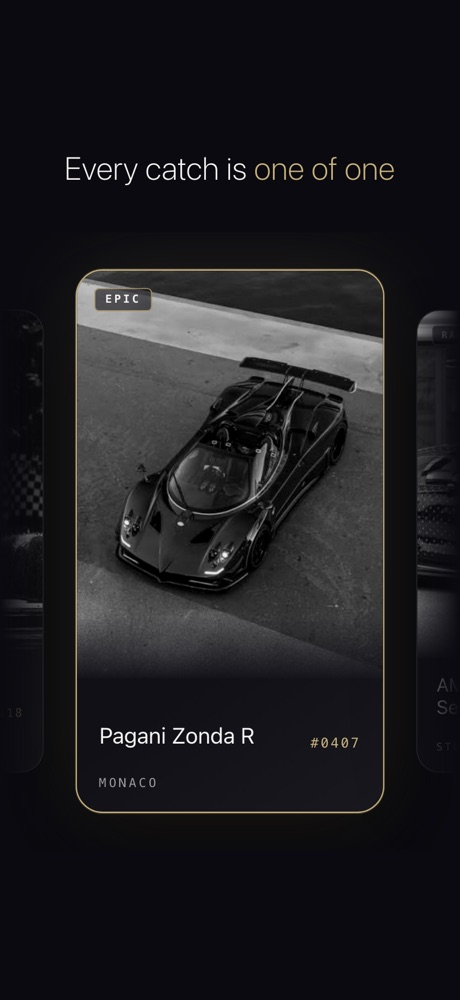
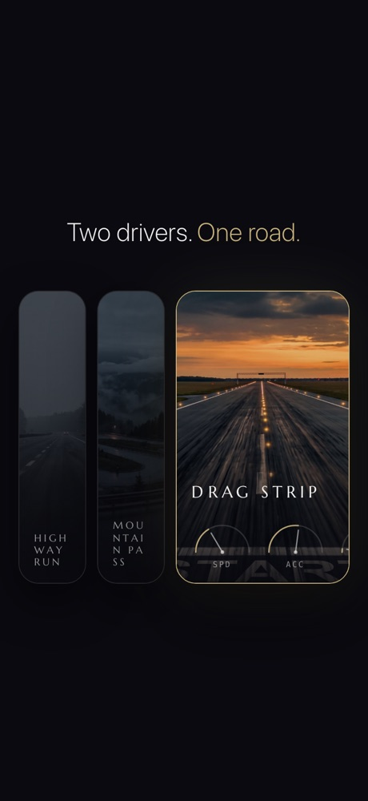
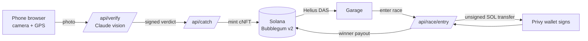

# RBOLA · რბოლა

[](https://app.rbola.fun)
[](https://rbola.fun)
[](https://explorer.solana.com/address/DKDRTpuPJA81GpA9xaQw4td9PjfoUNbw6D9zMs1VcWB5)
[](https://x.com/rbola_fun)
[](https://x.com/rbola_fun)
[](https://x.com/tatena_n/status/2095798920861331606)

**Own the cars that turn your head.** RBOLA (Georgian for "race") is a mobile web game where you photograph real cars in the street, own them as cards on Solana, and race them for SOL.

<p align="center">
  
  
  
  
</p>

## The loop

1. **Spot** a car in the street and open RBOLA in your phone browser. No app store, no extension.
2. **Capture** it with the in-app camera. AI verifies it's a real car in front of you; a photo of a screen, a print or an AI image is rejected.
3. **Own** it. The card is minted to your wallet as a compressed NFT: your photo is the art, the car's real factory specs are its stats.
4. **Race** it. Pick a track and a tier, get matched with another driver, both put in SOL, the specs decide, and the winner is paid on-chain.

**Rarity comes from the real world.** A car you see every day is common; a car that exists in the hundreds is legendary. Nobody designs the scarcity, the street does.

## Built for car lovers, not only crypto people

You log in with your email. [Privy](https://privy.io) creates a Solana wallet for you in the background: no seed phrase, no extension. Catching and minting are free for the player; the server pays the (fraction of a cent) mint cost.

## What's live

Everything below runs in the app at [app.rbola.fun](https://app.rbola.fun) on Solana mainnet.

- **AI catch verification.** A Claude vision model identifies make and model (that names the card, no user input) and judges authenticity. The verdict reaches the mint endpoint as an HMAC-signed token bound to the photo's hash, so the check can't be skipped. Details: [`docs/verification.md`](docs/verification.md).
- **Car catalog with real specs.** Every verified catch resolves to factory specs (hp, 0–100, top speed, weight) and a rarity tier. Cars not yet in the curated catalog get an AI-drafted spec on the spot and settle once reviewed. Published specs are frozen: never buffed, never nerfed.
- **Compressed NFT cards.** Minted with Metaplex Bubblegum v2 straight into the player's wallet; the garage reads them back from the chain through the Helius DAS API and shows them as a 3D card carousel you can flip to the spec side.
- **Races for SOL.** Three tracks (Drag Strip, Highway Run, Mountain Pass), each weighting horsepower, top speed and acceleration differently. Five tiers from Common to Legendary (0.001 to 0.02 SOL). Players on the same track and tier are matched, the result is a pure function of the cards' specs (no luck, no upgrades), and the winner gets the pot minus a 15% rake, paid on-chain. No rival in time means a full refund. Details: [`docs/races.md`](docs/races.md).
- **Installable PWA.** Mobile-first, works from the phone browser, can be added to the home screen.

## How it works



There are no custom smart contracts. Cards use Metaplex Bubblegum; races use a server ledger with every SOL movement as a real on-chain transfer to and from a dedicated race wallet. The server builds each entry transaction, the player signs it in their Privy wallet, and the server checks it byte for byte before broadcasting. Mint and race keys stay on the server and never reach the client.

## Tech stack

- **Solana:** Metaplex Bubblegum v2 (compressed NFTs) via Umi, Helius RPC + DAS API, `@solana/web3.js` / `@solana/kit`
- **Wallets:** Privy email login with embedded Solana wallets
- **App:** Next.js 16 (App Router), React 19, TypeScript, Tailwind CSS 4, PWA (getUserMedia camera, Geolocation API)
- **AI:** Anthropic Claude API (vision verification, spec drafting)
- **Infra:** Hetzner + Caddy + systemd for the app, Vercel for the landing page
- **Built with:** Claude Code, Claude Design, Colosseum Copilot

## Repo layout

```
rbola/
├── web/       Next.js app: landing, camera, garage, races, profile, and the API routes
│              for verification, minting and race payouts
├── docs/      how verification and races work
├── scripts/   Solana tools and the spikes run before building (tree, mint, read, AI recognition)
└── deploy/    server provisioning, deploy and rollback, systemd + Caddy config
```

## Run it locally

```bash
cd web
npm install
npm run dev     # http://localhost:3000
npm run build
```

Environment variables are listed in [`web/README.md`](web/README.md). Camera and wallet flows need HTTPS on a real phone, for example through a tunnel.

## Roadmap

- Duplicate-catch detection and GPS / timestamp plausibility checks
- Permanent card media hosting (Arweave)
- Card marketplace with a small fee on every trade
- Sponsored events with car brands
- More tracks and seasons; collections are never wiped

## Founder

Built by [Nino Tatenashvili](https://x.com/tatena_n), a software engineer from Tbilisi who grew up playing with cars instead of Barbies.
